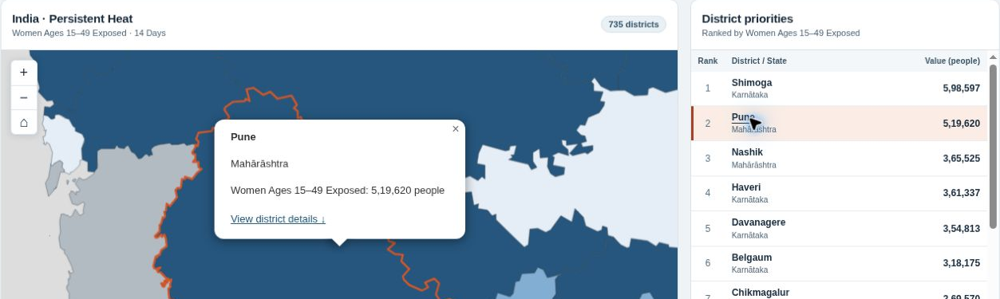

# Climate Pulse India

**UNFPA Population Intelligence Hackathon · Track 1**

Climate Pulse India turns weather forecasts and population estimates into a district shortlist for follow-up. It covers **735 Indian Admin‑2 districts** and three hazards: persistent heat, excessive rainfall and rainfall deficit.

**[Open the live dashboard](https://seanj1n1.github.io/climate-pulse-india-pages/#national-monitoring)** · [Methods and data](docs/methods-and-data.md) · [Historical evaluation](https://seanj1n1.github.io/climate-pulse-india-pages/#historical-evaluation)

## Try the Pune example

1. Open **National Monitoring** and select **Persistent Heat**, **14 Days**, **GEFS Hazard Probability** and **Top 25**. Use the 16 November 2026 forecast.
2. Select **Maternal Heat**, then **Women Ages 15–49 Exposed**. Pune moves from outside the weather Top 25 to **second** by expected exposure among women aged 15–49. Select Pune to see its forecast dates, population estimates and evidence status.
3. A district team could use this shortlist to decide where to check antenatal appointments, cooling and emergency referral readiness. Android is the reporting channel. Authorized reviewers use [Field Reports](https://seanj1n1.github.io/climate-pulse-india-pages/#field-reports) to confirm, reject or annotate records.

The paired comparison uses **702 districts with both metrics** and **25 review places per list**. The two lists share 17 districts. Pune’s estimated exposure is about **520,000 women aged 15–49**, averaged across 31 ensemble members.

The **Pregnancy × Persistent Heat** layer uses WorldPop’s **2015 annual pregnancy estimates** as a historical planning proxy. The published overlays have estimates for 706 districts per window, with 29 shown as No Data. Use local health records to verify current pregnancy and service needs. [WorldPop pregnancy data](https://hub.worldpop.org/geodata/summary?id=1029)

## Forecasts displayed in the demo

| Dashboard selection | GEFS issue (UTC) | Source target window |
| --- | --- | --- |
| 14 Days | 16 November 2026, 00:00 | 16–30 November 2026, end exclusive |
| 28 Days | 11 November 2026, 00:00 | 9–16 December 2026, end exclusive. Target week at a 28-day lead |

Each issue contributes 2,205 records across the three hazards. In the 28-day view, the 30 November–14 December header shows the calendar for days 15–28 of the latest cycle. District details identify the issue and window of the forecast being displayed.

## What was evaluated

The prospective 16 November forecast uses NOAA GEFS and WorldPop. A separate **2025 retrospective evaluation** compared conventional correction, direct Google PDFM augmentation and climate-conditioned PDFM.

For persistent heat at a 14-day lead, **direct PDFM had the lowest mean absolute error** for all-resident exposure. Under a fixed Top‑50 budget, **climate-conditioned PDFM** captured **21.03%** of reference exposure and **36** observed district-week heat events, versus **18.05%** and **30** with conventional correction. The reference exposure is estimated by overlaying observed heat with WorldPop. [Frozen results and reproducibility](docs/methods-and-data.md#2025-retrospective-evaluation)

The report submission and review workflow was tested with a sample record. A local clinic trial and independent evaluation of displacement or maternal-health outcomes remain pending.

## Access

National Monitoring and Historical & Evaluation are public. Connected Android reporting and Field Reports require the appropriate ArcGIS permissions. This public repository provides the compiled demo, public forecast snapshots and documentation. The hackathon submission ZIP contains the project source and reproduction notes. PDFM embeddings, private reports and restricted data are controlled separately.
